# METATRADER-KIMI

Лаборатория торговых систем для MetaTrader 5, созданных совместно с ИИ-ассистентами (QWEN, DeepSeek, Kimi / Muse Spark). В репозитории — код всех версий и направлений, готовые боты, бэктест-фреймворки, котировочные данные, обученные модели LightGBM, equity-графики и отчёты.

## 🎯 Суть системы на словах

Проект объединяет несколько веток одной исследовательской линии:

1. **Мартингейл-свечная система и её бэктест-фреймворк.** Стратегия с первоначальным объёмом 0.01 лота, где следующая позиция = сумма предыдущих × 1.5 (до 10 решений), на любом инструменте и таймфрейме. Фреймворки `backtest_framework*` (v2 → v7, включая версии «все инструменты») моделируют вход, усреднение, выходы по TP/SL, учитывают реальные лоты и `contract_size`. `quick_test_backtest.py`, `quick_test_v2.py`, `simulator.py` — быстрые синтетические проверки логики, `download_data.py` — выгрузка котировок из MT5.

2. **«Широкий мозг» (wide-brain V2 / V2.1).** Система портфельного ML-трейдинга: для каждой валютной пары своя модель (LightGBM) на мульти-таймфреймовых фичах (M15 + контекст M30/H1/H4), цель — сглаженный наклон цены (sigma), обучение и тест — walk-forward по окнам (train 1000 баров, fold 90, 10 окон), нормировка фичей по train-статистикам. В V2.1 — «абляция»: убраны кросс-активные головы и мета-контроллер риска, портфель равновесный (scale=1). `mt5_live_bot.py` — живой бот по wide-brain V2.1.

3. **«Система в одном файле» QWEN1–QWEN6.** Автономные версии торговой системы, вплоть до профессиональной v5.1: трейлинг-стоп, фильтр по ATR, динамический TP/SL на основе ATR, учёт спреда и комиссии, оптимизация Optuna, гауссово сглаживание (`gaussian_filter1d`), LightGBM. Отдельно — версия для крипты (QWEN5-ccrypta) и версия «чтоб понять суть» (упрощённая база).

4. **LightGBM-трейдеры и классификатор уровней.** `mt5_lgb_trader_v2.py` / `mt5_lgb_trader_v3.py` — production-трейдеры с исправленным look-ahead bias; готовые модели `lgb_model*.txt`; `уровни.py` — поиск уровней Support/Resistance + LightGBM с классами buy(1)/sell(2)/hold(0) на M15/M30/H1/H4.

5. **Крипта, AI-трейдинг и оптимизация.** `crypto_backtest.py` и `mt5_crypto_bot.py` — отдельная ветка wide-brain для криптоинструментов; `ai_trader.py` — AI-трейдер на Muse Spark; `KIMIAPI.py` — клиент Kimi API; `optimizer.py` — перебор параметров на MT5.

6. **Аналитика и дашборды.** Дашборды (`дашборд-QWEN6.py`, `дашборд-wide.py`, серия `дашборд-версия-1*`, включая GAUSSIAN ENSEMBLE), HTML-отчёты по итогам сессий (Qwen, DeepSeek, wide_brain), сводные JSON `champions_*.json` (simple → improved → pro → optimized → ultimate), результаты бэктестов в `results/`, `results_global/`, `results_real/`.

Данные: `data/` — котировки 12 пар (EURUSD, GBPUSD, USDJPY, GBPJPY, AUDUSD, AUDJPY, NZDUSD, USDCHF, USDCAD, EURJPY и др.) на M15/M30/H1/H4 + `manifest.json`.

## 📈 Графики эквити

| Trading results | Trading results (improved) | Trading results (ultimate) |
|---|---|---|
| 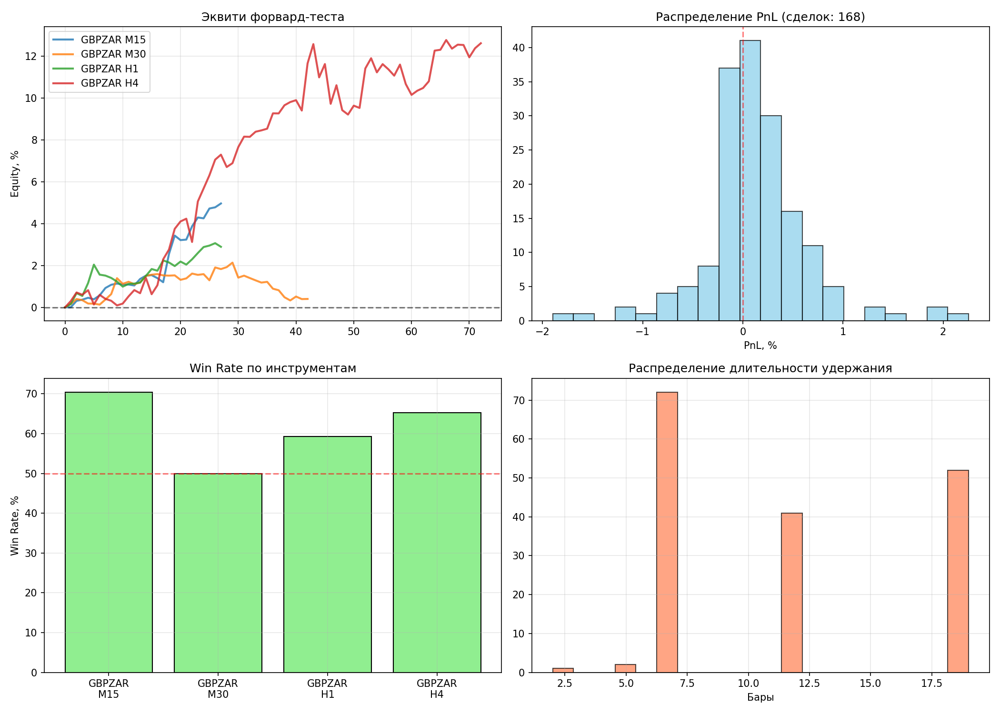 | 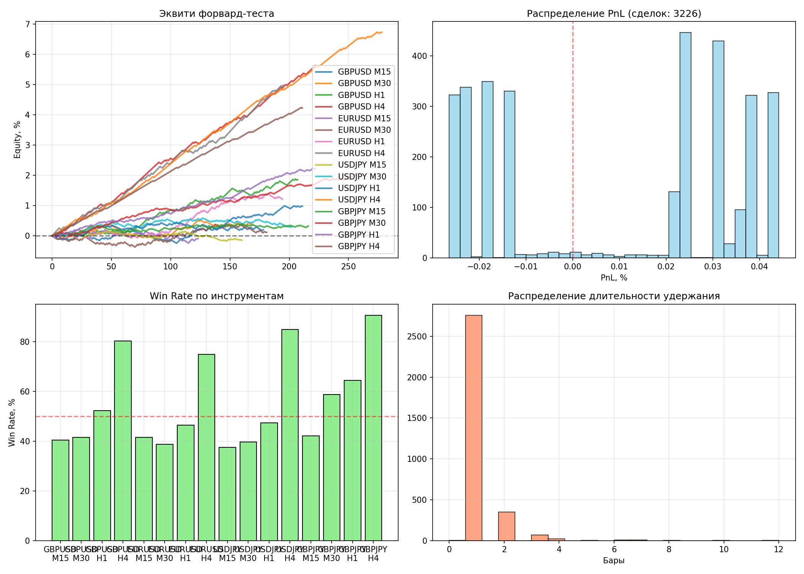 | 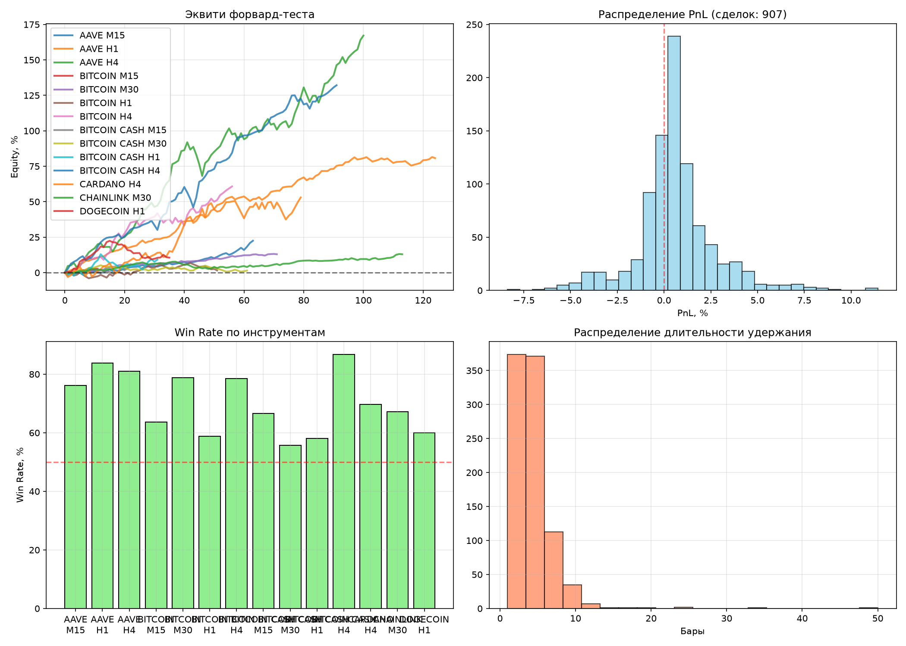 |

| Real | Pro |
|---|---|
| 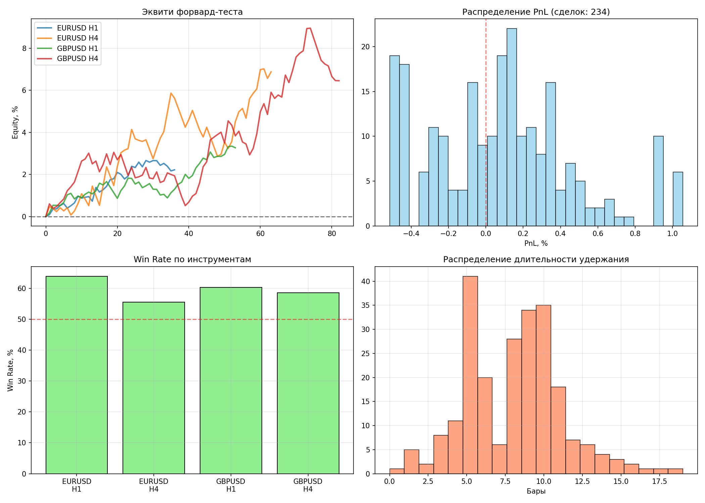 | 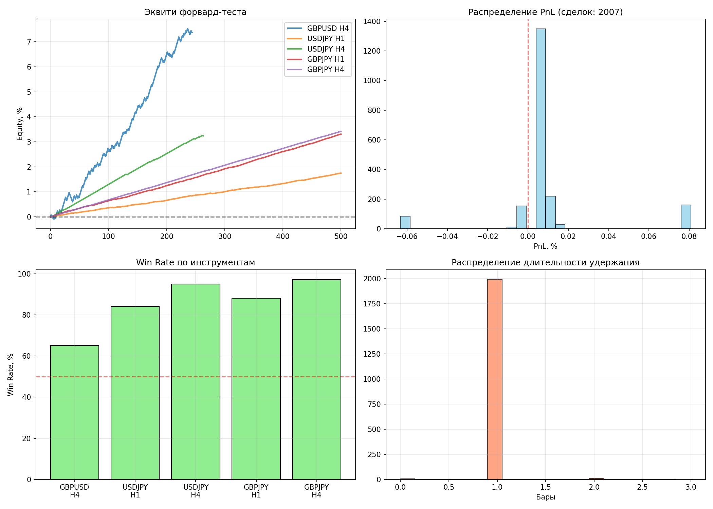 |

Wide-brain: эквити и уровни | Супербаза | Крипта
--- | --- | ---
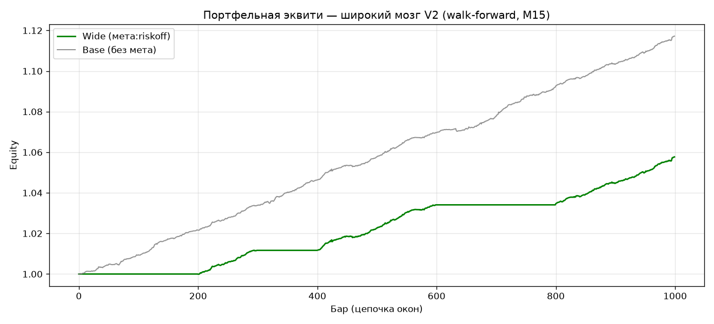 | 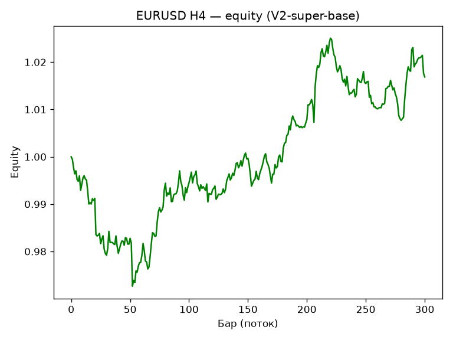 | 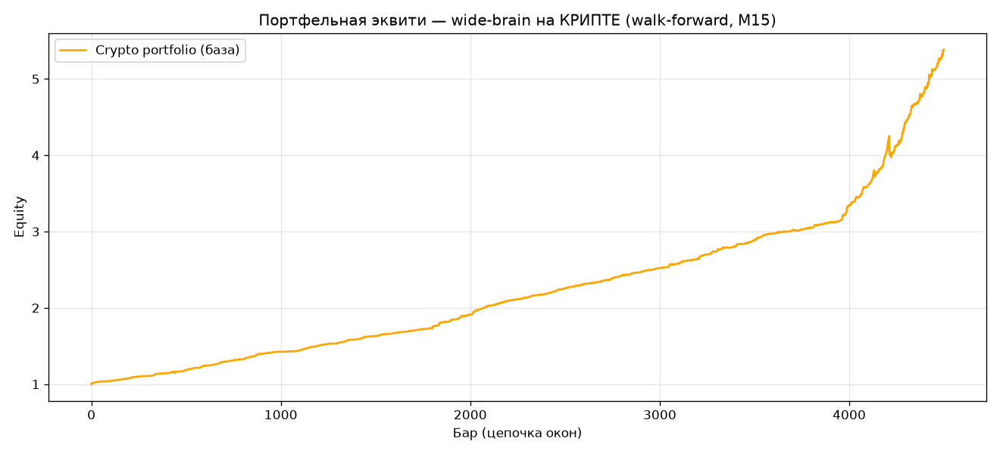

| Wide-brain base | Уровни |
|---|---|
| 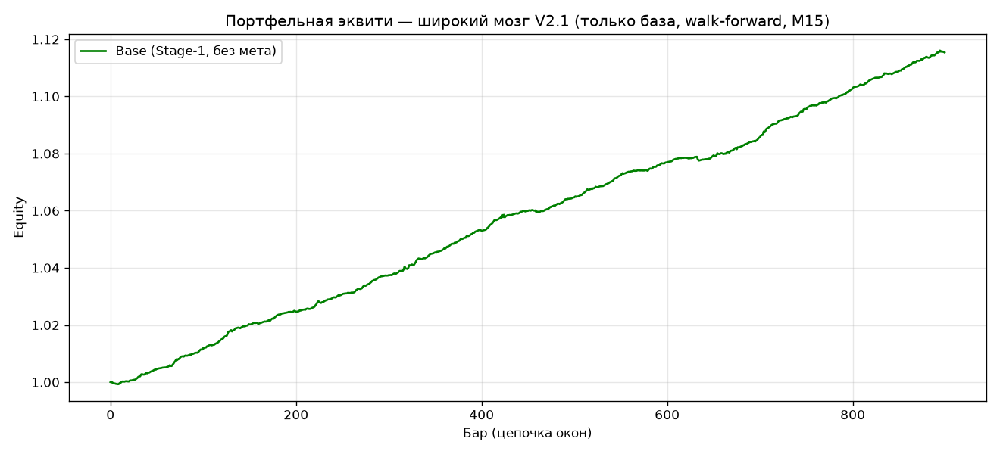 | 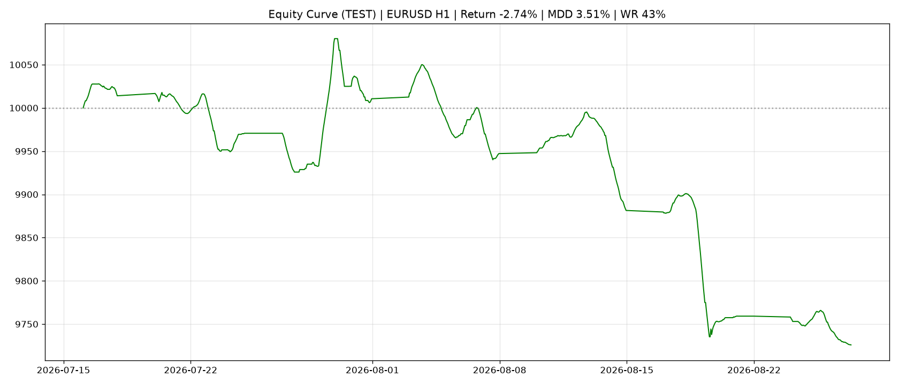 |

Эквити по инструментам из бэктеста фреймворка (`equity_charts/`, 19 PNG):

| EURUSD M15 | AUDUSD H1 | USDJPY H4 |
|---|---|---|
| 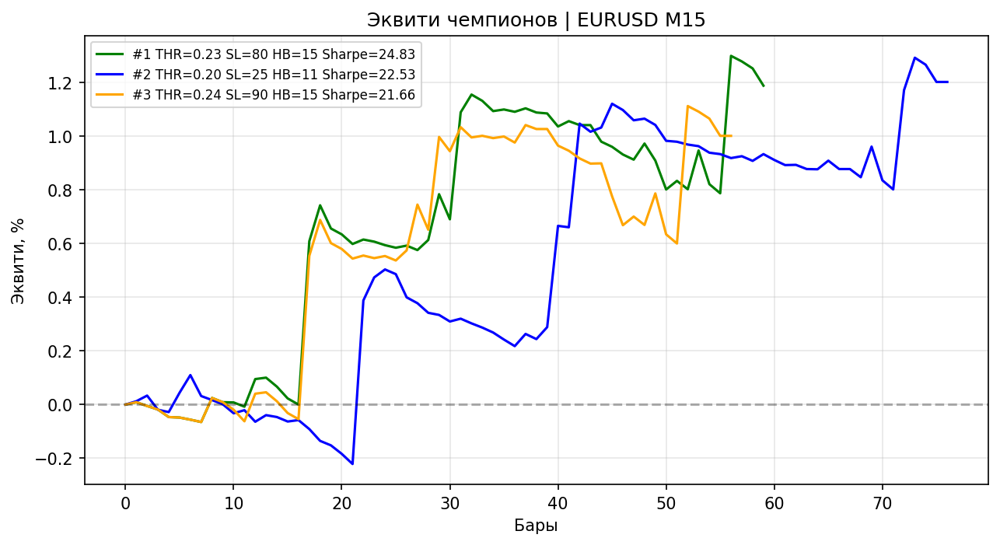 | 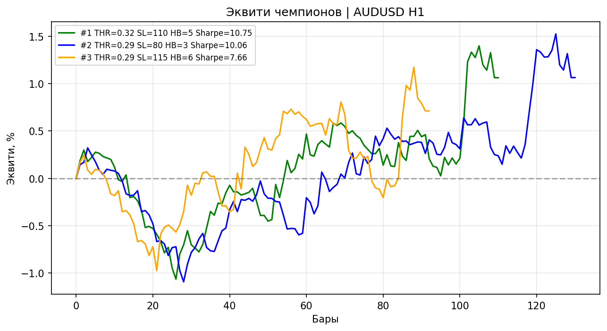 | 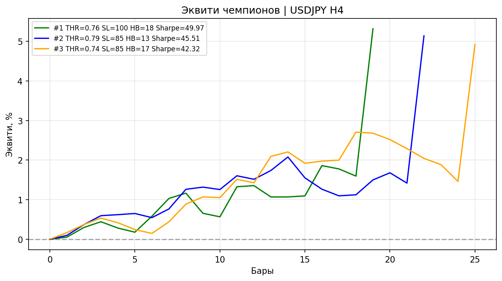 |

| GBPUSD H1 | USDCAD M30 | AUDUSD M30 |
|---|---|---|
| 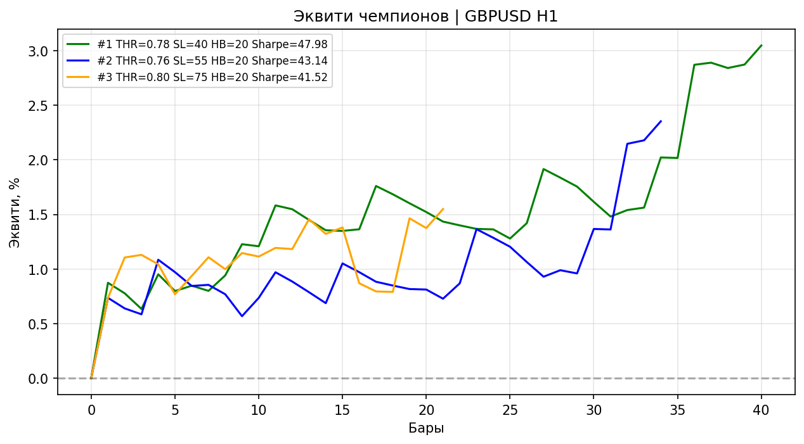 | 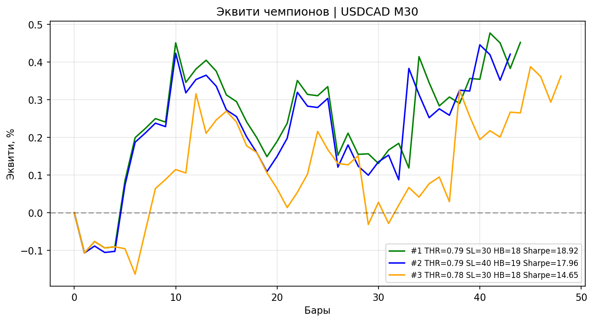 | 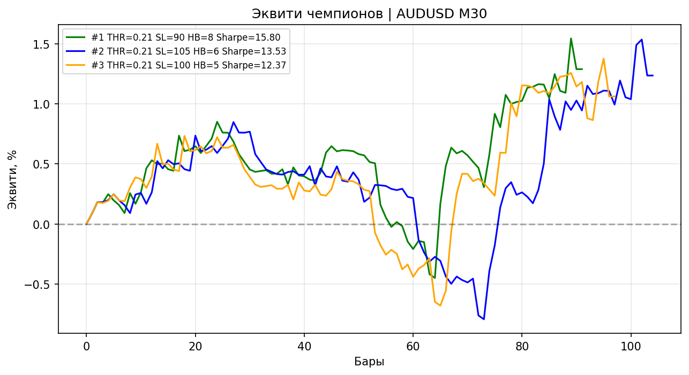 |

## 📁 Структура папок

| Путь | Назначение |
|------|------------|
| `wide_brain*.py` | «Широкий мозг» V2/V2.1 и его упрощённая база |
| `система-в-единм-файле-*.py` | автономные системы QWEN1–6 / DEEPSEEK (v5.1 = Gaussian Ensemble) |
| `mt5_lgb_trader_v2/v3.py`, `mt5_live_bot.py`, `mt5_martingale_bot*.py`, `mt5_crypto_bot.py` | live-боты MT5 |
| `backtest_framework*.py`, `quick_test_*.py`, `simulator.py`, `crypto_backtest.py` | бэктест-фреймворки и быстрые тесты |
| `уровни.py`, `optimizer*.py`, `ai_trader.py`, `KIMIAPI.py` | уровни + LightGBM, оптимизация, AI-трейдинг |
| `дашборд-*.py`, `*.html` | дашборды и HTML-отчёты |
| `data/` | котировки 12 пар × 4 ТФ + manifest |
| `equity_charts/`, `results*/`, `champions_*.json`, `lgb_model*.txt` | equity-графики, результаты, модели |
| `ТЗ.pdf` / `ТЗ.html` / `ТЗ_ GAUSSIAN ENSEMBLE v5.1.pdf` | техническое задание |
| `BACKTEST_README*.md` | документация бэктест-фреймворка |

## 🚀 Запуск

```bash
pip install -r requirements_backtest.txt   # MetaTrader5, pandas, numpy, lightgbm, optuna, matplotlib, openai
python quick_test_backtest.py              # быстрый тест без MT5 (~10 сек)
python backtest_framework.py               # полный бэктест (до 30 инструментов)
python система-в-единм-файле-QWEN6.py      # автономная система v5.1
python дашборд-QWEN6.py                    # дашборд
```

Требуется запущенный терминал MetaTrader 5 и доступ к данным по инструментам.

## ⬆️ Что не выгружено в репозиторий

Через `.gitignore` отсечены: `.venv/` (527 МБ), `__pycache__/`, логи (`*.log`, `bot_log.txt`, `ai_log.txt`), архивы кода (`*.zip`), обучающие выборки `train_data*.csv` (93 МБ) и `bot_status.json`.

---

> **ВНИМАНИЕ:** Мартингейл и любые торговые системы — высокий риск. Всё выложено исключительно в ознакомительных целях. Проверяйте на демо.
